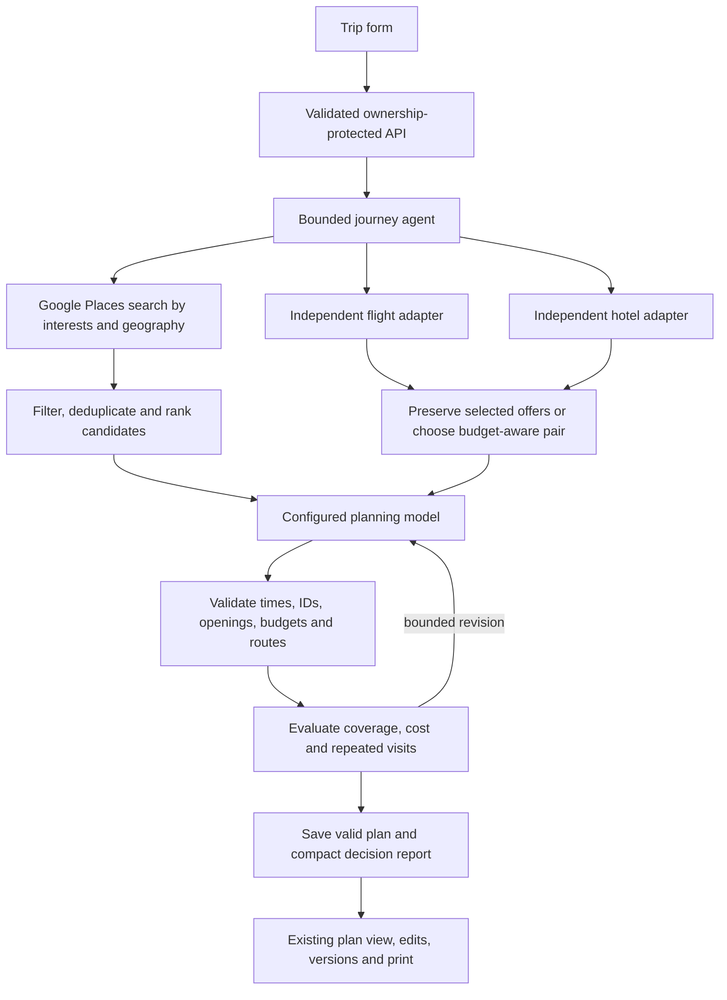

# Backend and journey agent implementation

> Superseded on 26 October 2026 for language-model planning. Current planning uses local rules without Ollama or external LLMs. Read PROJECT-STATE.md and docs/RULE-BASED-PLANNING.md. Historical verification below does not describe the active engine.

Current scope: form-driven trip planning. Chatbot and RAG are deferred; see `CHATBOT-DEFERRED.md`.

## Execution order

- [x] Save decisions and the chatbot checkpoint.
- [x] Complete bounded journey-agent orchestration with an honest persisted decision report.
- [x] Rank live Google candidates by interests, proximity and supported metadata, removing closed/invalid/duplicate candidates and preserving variety.
- [x] Preserve traveler offer choices; choose budget-aware combinations when choices are missing.
- [x] Validate all generated IDs, dates, opening periods, transfer gaps and budgets; retry only bounded, repairable failures.
- [x] Keep Google Routes independent; verify real durations when enabled and mark estimated transfers otherwise.
- [x] Prepare flight/hotel provider contracts and credential readiness checks; Amadeus is provisional pending provider choice.
- [x] Verify local model generation when runtime is available, without making it a chatbot.
- [x] Run backend tests, frontend build, and a MySQL journey-agent round trip.
- [x] Refresh project checkpoint and list remaining external dependencies.

## Target flow

## Boundaries

Flight/hotel providers have not been chosen and their live credentials are not available. Mock responses are test fixtures, never proof of live-provider readiness. Provider-specific changes may be necessary after selection. Unknown activity prices and missing opening data remain unknown. Route checks do not guarantee future traffic or real-world availability. Deployment is separate from local verification.

## Verified implementation — 25 October 2026

- 55 backend tests pass; frontend production build passes.
- MySQL schema/auth/versioning/ownership/cascade integration passes on gilgamish_test_agent; agent report round-trips correctly and edited versions clear stale reports.
- Real local model smoke check: two Arabic days, three activities, 68.882 seconds. See verification/local-agent.json.
- Full live acceptance: real Google Places + real Google Routes + local Ollama + SQL persistence; two days, six activities, two route-checked days, 65.238 seconds. Flights/hotels were explicit fixtures; all six activity fees were unknown and remained labeled. See verification/live-journey.json. Test account was deleted after the check.
- Local configuration now selects places=google, routes=google, ai=ollama, flights/hotels/destinations=mock. Health reports planningMode=agent and chatbot=deferred.
- START-GILGAMISH.cmd and scripts/start-local.ps1 start/check the local model, backend and frontend. Launcher executed successfully at http://localhost:5180.

## Still external or deliberately unfinished

- Flight/hotel vendor names and live credentials; final vendor-specific acceptance tests. Existing provisional Amadeus implementation supports adults and one hotel room; child/multiple-room support needs an explicit adapter/form extension.
- The recommender is transparent interest/proximity/diversity ranking over Google candidates, not the Colab model or a newly trained ML model.
- Known city scopes use conservative planning areas; unknown city codes rely on the city text query, not a verified administrative boundary.
- Unknown activity fees, holiday-specific openings, future traffic, arbitrary user-instruction interpretation and factual accuracy of model-generated reasons are not guaranteed by validation.
- Local PC must stay running for local inference; production hosting/security/monitoring are separate work.
- Chatbot/RAG and all informational-chat provider choices remain deferred.
